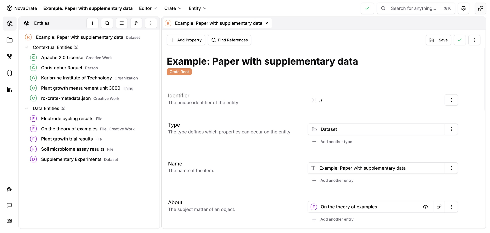

---
# Use plain text in the title; do not use backticks for code formatting.
title: 'NovaCrate: a web-editor for Research Object Crates'
tags:
  - ro-crate
  - editor
  - open science
  - fair
  - research data management
authors:
  - name: Christopher Raquet
    orcid:  0009-0003-2196-9187
    equal-contrib: true
    affiliation: 1 # (Multiple affiliations must be quoted)
affiliations:
 - name: Karlsruhe Institute of Technology, Germany
   index: 1
   ror: 04t3en479
date: 2026
bibliography: paper.bib
---

# Summary

Enabling a FAIR exchange of research data is a key concern of open science.
Research Object Crate (RO-Crate) is a packaging format that captures both data
and structured metadata in a single file, supporting the
exchange, reuse, and machine-actionability of scientific data [@soiland-reyes_packaging_2022]. For wide community adoption,
RO-Crates must be tangible for their users, namely researchers, data stewards, and software developers. For this purpose we present
NovaCrate, a web-based tool for creating, editing, and visualizing RO-Crates. NovaCrate is an open-source
project licensed under the Apache-2.0 license. The source code is available on [GitHub](https://github.com/kit-data-manager/NovaCrate) 
and archived on Zenodo with the
DOI [10.5281/zenodo.15183573](https://doi.org/10.5281/zenodo.15183573). An official instance is
hosted at [novacrate.datamanager.kit.edu](https://novacrate.datamanager.kit.edu/editor/).

# Statement of need

An RO-Crate typically consists of a single zip archive that contains data in the form of files
and folders, as well as structured metadata organized in one JSON-LD file [@soiland-reyes_packaging_2022]. 
While this structure is inherently accessible to machines, humans will struggle to gain
value from the metadata file without further assistance.
We believe that it is crucial for users of the RO-Crate format to be able to understand
the contents and relationships in their RO-Crates through a purpose-built tool.

NovaCrate allows researchers to directly interact with the metadata of their RO-Crate.
They can see how each metadata entity relates to the files and folders in the archive.
The terms used in the metadata are further enriched with helpful comments, and the integrated
validator makes it easy to make valid RO-Crates and follow best practices. NovaCrate may also
be useful to developers of RO-Crate workflows and automations, who can use NovaCrate to inspect
and validate the inputs and outputs of their software. Data curators can use NovaCrate to
quickly view and understand RO-Crates that have been published in a repository.

# State of the field

There are currently three distinct editors available for working with RO-Crates: 
NovaCrate, Crate-O [@peter_sefton_and_contributors_crate-o_2025], and Describo [@marco_la_rosa_and_contributors_describo_2023], although Describo was discontinued
in 2025.
NovaCrate is the newest addition to the field and was developed from the ground up
with improved portability, usability, and maintainability in mind. The efforts that were
made to achieve all three points are outlined in \autoref{software-design}.

The RO-Crate specification was originally published in 2019. The specification has reached version 1.3.0 at the time of
writing [@sefton_ro-crate_2026]. A rich ecosystem of services and tools has already emerged to support researchers, data
stewards, and software developers, as outlined in the tools list [@noauthor_tools_2026] on the RO-Crate website.
Numerous software packages exist to manipulate RO-Crates programmatically, such as
`ro-crate-java` [@tzochev_ro-crate-java_2026], `ro-crate-js` [@sebastian_ro-crate-js_2026], `ro-crate-py` [@bauer_ro-crate-py_2026], and `ro-crate-rs` [@burridge_ro-crate-rs_2026].
NovaCrate contributes to this ecosystem by allowing users
to directly visualize and interact with the metadata of an RO-Crate through a GUI.

# Software design

NovaCrate emphasizes an intuitive
user interface as well as good usability. This is vital
to ensure the accessibility of the editor for a wide range of people, with little to no
knowledge of the RO-Crate specification required.

The core principles of NovaCrate are:

- The editor must be usable in all common browser environments 
- The editor should not depend on a specific RO-Crate package 
- The editor should have a high degree of usability

The software architecture of NovaCrate is designed
around these principles. NovaCrate can be separated into a backend and frontend as
suggested in \autoref{fig:frontend-backend}, 
where the frontend is responsible for providing the editor's UI
functionalities, and the backend is responsible for handling the RO-Crate data and metadata.

The Crate Service receives commands to update the metadata of the RO-Crate or to create, move or delete files
in the RO-Crate archive. The Repository Service is responsible for listing stored RO-Crates and creating new ones.
The frontend does not need
to know how the backend is implemented, nor where it is executed or how data is exchanged between backend
and frontend. In its current implementation, the backend of NovaCrate runs directly
in the browser in a separate process. Data is stored on the device in the Origin Private File System [@mdn_contributors_origin_2025] of the browser.
This architecture allows NovaCrate to be adapted to different environments in the future, such as:

- A desktop application with direct manipulation of RO-Crates on the file system
- An embedded tool in RO-Crate repositories to inspect and possibly manipulate RO-Crates in the repository
- A standalone web application with a browser-based file system

The frontend of NovaCrate is further divided into a typical Model-View-Controller (MVC) architecture.
The global state is stored in several distinct state stores that do not
depend on each other. The view is built using the component-based frontend library React [@meta_open_source_react_nodate], which
allows declaring reusable components that can be placed anywhere throughout the application.
The controller-part of the MVC architectural pattern is not discretely implemented, but rather
consists of state manipulation actions in the state stores or of component hooks (reusable
functions integrated into the React lifecycle). NovaCrate implements its own "actions" system
similar to those seen in popular code IDEs, where actions can be centrally defined and activated
based on global state, and can then be called from anywhere.

With the recent addition of an agentic AI assistant within NovaCrate, we demonstrated that all of the
editor's capabilities can easily be called by an AI agent. This indicates a properly working separation
between UI and functionality and a healthy and maintainable architecture.

Care was taken to make sure the frontend of NovaCrate is responsive and usable with little to no introduction. 
The design of the editor is based on best practices established in the books
of Krug [@krug_dont_2014], Valencia [@valencia_designing_2019], and Shneiderman et al. [@shneiderman_designing_2017].
NovaCrate was tested in a small internal user study as outlined in the bachelor thesis in which NovaCrate
was initially developed [@raquet_design_2024].

# Research impact statement

We believe that research data management and especially open
research exchange are absolutely necessary to increase reproducibility and reusability in open science, as 
envisioned by the FAIR principles.

To understand the usage of our tools, we record anonymous usage numbers of the official NovaCrate instance.
The results are not publicly accessible for privacy reasons. Bots, scrapers, and uptime monitors are automatically 
removed from these statistics on a best-effort basis.

See an excerpt of the results in the table below:

| Metric                                             | Value |
|----------------------------------------------------|------:|
| Unique Users visiting the landing page             |   1070 |
| Unique Users visiting the main menu                |   195 |
| Unique Users actively using the editor             |    71 |
| Total number of sessions in the editor |  179 |
| Chat Messages sent to the AI assistant |  103 |

Data was collected over 30 days, from 18th of October to the 17th of November 2026
Unique users are estimated by counting unique IP addresses. 
Sessions are counted by the number of times the worker script for the editor was loaded. We assume that it stays in cache for the duration of one working session, e.g. one day of work within NovaCrate.

# AI usage disclosure

Several different AI models were used throughout the recent development of NovaCrate to aid
with code generation. The general software architecture was designed without AI help. AI code was always
cautiously reviewed and tested through the included extensive test suite.

While it is not possible to fully reconstruct which AI models were used throughout the development
of NovaCrate, the following models were in use at some point:

- DeepSeek v4.1 Flash
- DeepSeek v4 Flash
- GLM v5.3 Flash
- GLM v5.2
- Claude Opus 4.8
- GitHub Copilot

The following models were used for proofreading the contents of this paper:

- DeepSeek v4.1 Flash

# Acknowledgements

We acknowledge the contributions and bug reports
received from the RO-Crate community. NovaCrate is part of the [Helmholtz Cloud](https://helmholtz.cloud/services/?filterSearchInput=novacrate&serviceID=a6d8acdd-a37f-4adf-b0de-edefe8cd5653) and is funded by the [FAIR Data Commons](https://helmholtz-metadaten.de/fair-data-commons/overview) project of the [Helmholtz Metadata Collaboration](https://helmholtz-metadaten.de/). Numerous people from the department of [Data Exploitation Methods](https://www.scc.kit.edu/en/aboutus/dem.php) at the [Scientific Computing Center](https://www.scc.kit.edu/en/index.php) of [Karlsruhe Institute of Technology](https://www.kit.edu/english/index.php) have played a significant role in the development and dissemination of NovaCrate, including but not limited to Thomas Jejkal, Maximilian Inckmann, Rossella Aversa, Andreas Pfeil, Sabrine Chelbi, and Gabin Thibaut Oumbe Tekam.

# References
